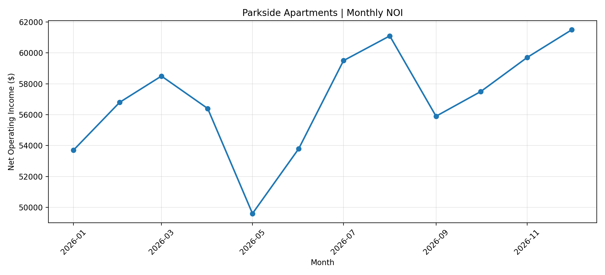

# AI-Driven-Business-Intelligence-Presentation-Automation-Pipeline
Python-based multifamily real estate reporting automation with financial KPI analysis and AI-generated investor summaries.

## Financial Performance Visualization

### Monthly Net Operating Income (NOI)

This chart was automatically generated using Python, Pandas, and Matplotlib from synthetic multifamily property data.

  
